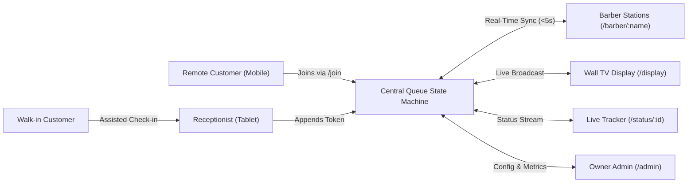

# 01 — Project Brief & Product Requirements Document (PRD)

> **VÉLORA — Real-Time Salon Queue Management System**  
> *The Art of Elevation · Beauty · Style · You*  
> *Modern Web Application (React + Vite + Tailwind CSS)*  
> *Location Target: Flagship Salons in Sānand, Satellite, and Sindhu Bhavan, Gujarat*

---

## 1. Executive Summary & Problem Statement

### 1.1 The Weekend Salon Bottleneck
High-end and mid-to-high-tier salons face an intense operational crunch during peak periods—specifically Friday evenings, Saturdays, and Sundays. In conventional salon environments, queue management relies entirely on physical presence, paper registers, or informal verbal agreements handled at the front desk. This analog approach produces severe pain points:

1. **Lobby Congestion & Degraded Ambiance**: Waiting lounges become overcrowded with 10–25 waiting patrons, eroding the relaxing, premium atmosphere that luxury salons charge a premium to provide.
2. **Customer Uncertainty & Time Waste**: Guests are routinely told vague estimates like *"15 to 20 minutes"*, which stretch into 60–90 minutes. Patrons are forced to remain physically trapped in the waiting area for fear of losing their turn.
3. **Queue Disputes & Social Friction**: Verbal disputes arise frequently between walk-ins, phone callers, and remote arrivals (*"I was here before him"*, *"Why did he get seated first?"*), putting the receptionist in an awkward, confrontational position.
4. **Walkaway Customer Attrition**: Frustrated customers leave without notifying staff, leaving the queue stale and causing stylist idle time when non-existent guests are called.
5. **Stylist Dispatch Inefficiencies**: Stylists cannot forecast upcoming work, cannot signal when their chair is free without leaving their station, and cannot easily respect customer barber preferences versus FIFO dispatch.

### 1.2 The Solution
**VÉLORA Real-Time Queue Management System** is a real-time, responsive multi-surface web platform that completely eliminates physical waiting room chaos. By virtualizing the queue into a synchronized, transparent, and bilingual digital engine, customers can join remotely from their phones or register at reception, track their exact live position and countdown wait time from anywhere (a coffee shop, office, or home), and arrive exactly when their chair is ready.

Simultaneously, front-desk staff, workstation barbers, and lounge patrons operate in lockstep through dedicated, synchronized views powered by real-time state synchronization, smart FIFO preference routing, and subtle acoustic alerts.

---

## 2. Vision & Project Objectives

### 2.1 Core Objectives
- **Zero-Friction Queue Access**: Allow clients to join the queue in under 30 seconds from any mobile device without mandatory app installation or account creation.
- **Synchronous Salon Operations**: Deliver real-time synchronization (< 5-second latency) across all client, workstation, reception, and ambient display interfaces.
- **Algorithmic Transparency**: Eliminate verbal guesswork with deterministic token numbers (e.g., `A101`, `A102`) and dynamic wait estimates calculated from active chair throughput.
- **Smart Stylist Preference Routing**: Respect customer preferences for specific stylists while automatically prioritizing "Any Stylist (Fastest)" requests through smart FIFO dispatch.
- **Cultural & Regional Resonance**: Provide first-class bilingual support in **English** and **Gujarati (ગુજરાતી)** across all client-facing and operational screens.

---

## 3. Target Users & Detailed Personas

### 3.1 Persona 1: The Remote Urban Professional
* **Name**: Kavita Patel
* **Demographics**: 29, Product Specialist, Sānand / Ahmedabad
* **Device**: iPhone 15 Pro (Safari Mobile)
* **Behavior & Needs**:
  - Extremely busy on weekends; hates sitting in a salon lounge for an hour reading magazines.
  - Wants to join the queue from home while getting ready or from a nearby café.
  - Needs a trustworthy countdown timer and an unambiguous alert ("It's your turn!") so she knows precisely when to drive to the salon.
* **Core Action**: Visited `/join`, chose Haircut & Hair Spa with Meera, receives token `A104`, tracks progress on `/status/104`.

### 3.2 Persona 2: The Spontaneous Walk-In Customer
* **Name**: Rohan Mehta
* **Demographics**: 34, Businessman, Satellite Area
* **Device**: Offline / Walk-in patron (carries Android device)
* **Behavior & Needs**:
  - Drops into the salon spontaneously without pre-planning.
  - Wants to know immediate wait time before committing to stay.
  - Walks up to the front desk, gives name and mobile number, receives an instant token, and watches his number appear on the lounge TV display.
* **Core Action**: Checked in via receptionist on `/reception`, receives physical token card or glances at `/display`.

### 3.3 Persona 3: The Front Desk Coordinator (Receptionist)
* **Name**: Priya Shah
* **Demographics**: 25, Front Desk Manager
* **Device**: 11" iPad Air mounted at reception desk (Chrome / Safari Tablet)
* **Behavior & Needs**:
  - High cognitive load during peak hours: phone ringing, walk-ins approaching, barbers signaling.
  - Needs a high-visibility, single-touch dashboard to register walk-ins in under 15 seconds.
  - Needs immediate visibility into all chairs, who is in service, who is waiting, and quick override controls for no-shows or cancellations.
* **Core Action**: Monitors `/reception`, taps "Add Walk-In", manages no-show grace timers, re-sequences if needed.

### 3.4 Persona 4: The Master Barber / Stylist
* **Name**: Kabir Varma
* **Demographics**: 31, Senior Stylist & Grooming Specialist
* **Device**: 8.4" Android Tablet / Smartphone mounted at styling mirror
* **Behavior & Needs**:
  - Focused on haircutting precision and client rapport; cannot touch complex software with wet/chemical-stained hands.
  - Requires giant, single-tap buttons: **"Call Next"**, **"Start Service"**, **"Mark Done"**.
  - Must only be assigned customers who requested him specifically or who selected "Any Available Barber".
* **Core Action**: Logs into `/barber/Kabir`, taps "Call Next Guest", serves patron, taps "Complete", queue automatically recalculates.

### 3.5 Persona 5: The Salon Owner / Director
* **Name**: Jigneshbhai Desai
* **Demographics**: 48, Salon Entrepreneur & Franchise Owner
* **Device**: MacBook Air / iPad Pro
* **Behavior & Needs**:
  - Wants real-time transparency over chair utilization, average wait times, and daily throughput.
  - Requires instant capability to toggle queue acceptance on/off (e.g., closing queue 45 minutes before closing time).
  - Needs service catalog management (adjusting prices, service durations, and staff rosters).
* **Core Action**: Accesses `/admin`, configures 30-minute auto-cutoff, audits daily analytics, toggles barber on-break statuses.

---

## 4. Scope & Out-of-Scope Boundaries

To maintain relentless execution speed, architectural stability, and extreme UX clarity, the boundaries of this release are defined with absolute precision:

| Feature Dimension | Strictly In-Scope (Phase 1 Production) | Explicitly Out-of-Scope (Future / Prohibited) |
|---|---|---|
| **Queue Type** | **Same-day Real-Time Virtual Queue** (Day-of FIFO dispatch) | **No future calendar appointment scheduling** (no multi-day time-slot pickers, no 2-weeks-in-advance booking). |
| **Payment Handling** | **In-Person Settlement** (Cash, Card, UPI at salon reception upon completion) | **No online payment gateways** (no Razorpay, Stripe, or UPI escrow; eliminates gateway drop-offs & refund disputes). |
| **Messaging / Notifications** | **In-App Live Status URL, Full-screen Alerts, Web Audio Chime, PWA Web Notifications** | **No paid third-party SMS or WhatsApp Business APIs** (eliminates DLT registration delays, SMS per-message fees, and network SMS latency). |
| **Customer Identification** | **Lightweight Name + 10-Digit Mobile Number** (with duplicate active token guard) | **No complex authentication / password logins** (no OTP login barriers for guests; status tracked via secure URL token ID). |
| **Multi-Language** | **Centralized Bilingual Localization (English & Gujarati)** with persistent toggle | **No multi-dialect automatic audio transcription**; focus is crisp, accurate UI text strings. |
| **Hardware Integration** | **Standard Responsive Web Browsers** (Mobile Safari/Chrome, Tablet Chrome, Wall TV Smart Browser) | **No thermal POS receipt printer drivers or hardware barcode scanners** (tokens are visual on screen). |
| **Loyalty & Marketing** | **Daily Operational Analytics** (Wait times, throughput, chair utilization) | **No customer loyalty points, referral bonuses, or promotional SMS marketing engines**. |

> [!IMPORTANT]
> **Why Out-of-Scope decisions protect product success:**
> Avoiding online payments and SMS APIs eliminates external network dependencies, recurring API costs, and compliance overhead. By focusing 100% on the real-time queue state machine and zero-friction client UX, the salon achieves lightning-fast queue turnover and zero setup friction for patrons.

---

## 5. Core Feature Matrix

### 5.1 Remote & Walk-in Check-In
- **Multi-Service Selection**: Guests can pick up to 3 services simultaneously (e.g., Haircut + Beard Trim + Hair Spa). The system aggregates the total estimated duration (e.g., 30m + 20m + 45m = 95m) and price.
- **Stylist Preference Toggle**:
  - `Any Barber (Fastest)`: First available on-duty chair claims the token.
  - `Specific Barber`: Token is reserved exclusively for the requested stylist's personal queue.
- **Duplicate Active Number Guard**: A phone number currently in `WAITING`, `CALLED`, or `IN_SERVICE` state cannot generate a second token. Once marked `COMPLETED` or `CANCELLED`, the number is instantly unlocked.
- **Walk-in Desk Rapid Entry**: Receptionist can generate a walk-in token in 3 taps, immediately appending the guest to the bottom of the FIFO queue.

### 5.2 Real-Time Live Status Tracking (`/status/:id`)
- **Dynamic Position In Line**: Shows exact number of clients ahead for their selected stylist route.
- **Algorithmic Countdown Wait Estimate**: Recalculates dynamically whenever a chair finishes, calls next, or when a stylist goes on break.
- **Approaching Turn Warning**: When position drops to #1 or estimated wait is $\le 10$ minutes, UI morphs to warm amber warning: *"Please start heading to the salon"*.
- **"It's Your Turn!" Fullscreen Alert**: When status transitions to `CALLED`, customer screen vibrates, pulses with gold aesthetic banner, and displays the assigned chair number and stylist name.
- **Voluntary Cancellation**: Modal confirmation allowing patrons to surrender their token if plans change, immediately cascading wait-time reductions to everyone behind them.

### 5.3 Smart FIFO Queue Dispatch Engine
- Standard FIFO fails when customers pick specific barbers. Luxe Salon uses **Smart Preference FIFO Dispatch**:
  - When Barber $X$ clicks "Call Next", the engine scans the queue from head to tail.
  - It selects the first patron who requested Barber $X$ **OR** who selected "Any Available Barber".
  - Patrons waiting for Barber $Y$ or Barber $Z$ remain safely in their respective queue positions without being skipped or knocked out.
- **Single-Chair Concurrency Guard**: A stylist cannot call a new guest while their current station status is `IN_SERVICE`. They must complete or release the active guest first.

### 5.4 Workstation Ergonomics (`/barber/:name`)
- Dedicated mirror-mounted tablet interface designed for tactile simplicity:
  - Current client card with services list, customer name, elapsed timer, and target service duration indicator.
  - "Upcoming in my queue" preview list (next 3 customers).
  - One-tap status transitions: `Call Next` $\rightarrow$ `Start Service` $\rightarrow$ `Mark Done`.
  - Stylist Shift Status Toggle: `On Duty` / `On Break` / `Off Duty`.

### 5.5 Lounge Wall TV Ambient Display (`/display`)
- Designed for 1080p / 4K landscape screens mounted in the waiting lounge:
  - High-contrast, non-scrolling split layout: Left side displays active chairs ("Now Serving"), right side displays upcoming waiting queue.
  - Highlighting active tokens with distinct stylist names, service summaries, and chair numbers.
  - **Visual Attention Flash**: Flashing border pulse when a new token is called.
  - **Ambient Acoustic Chime**: Synthesized luxury two-tone chime via HTML5 Web Audio API (no external MP3 asset dependency) whenever a guest is called.

### 5.6 Receptionist Command Center (`/reception`)
- Comprehensive overview of all active, waiting, and completed tokens for the day.
- Rapid-action modal to register walk-ins.
- No-show 10-minute grace period timer.
- Capacity to mark no-shows, eject cancelled tokens, or manually reassign a client to another barber if mutually agreed.

### 5.7 Owner Administration & Capacity Controls (`/admin`)
- **Master Queue Toggle**: Instant switch to open or close remote queue registration.
- **30-Minute Auto-Cutoff Rule**: Automatic lock on remote joins when current backlog exceeds salon closing time minus 30 minutes.
- **Staff Roster Management**: Add/edit stylists, assign chair numbers, toggle on-duty statuses.
- **Service Catalog**: Manage services, durations (15m to 120m), and INR prices.
- **Daily Performance Metrics**: Total guests served, average wait time, chair utilization rate, no-show rate.

### 5.8 Centralized Bilingual Localization (EN / GU)
- Native bilingual support for **English** and **Gujarati (ગુજરાતી)**.
- Persistent header language switcher (`EN` / `ગુજ`).
- Full translation dictionary covering all customer flows, error prompts, form labels, chair instructions, and TV announcements.

---

## 6. Success Metrics & KPIs

1. **Wait Time Perception**: 85%+ reduction in perceived customer wait frustration (measured by customer feedback).
2. **Lobby Congestion Reduction**: Average physical waiting room occupancy reduced from ~18 patrons to $\le 4$ patrons during peak weekend hours.
3. **Queue Dispute Frequency**: Reduced from 3–5 verbal disputes per weekend to exactly zero, due to transparent sequential token numbers.
4. **Stylist Idle Time**: Average turnaround time between clients reduced from 8 minutes to under 90 seconds.
5. **No-Show Rate**: Maintained below 5% through dynamic countdown warnings and automated 10-minute grace timer ejection.
