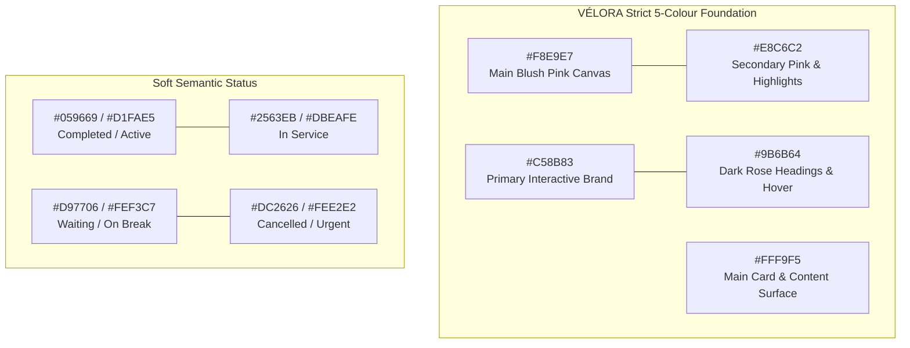

# 02 — Visual Design System & Screen Specifications

> **VÉLORA — Real-Time Salon Queue Management System**  
> *The Art of Elevation · Beauty · Style · You*  
> *Visual Language extracted directly from the Reference Template Aesthetic & Prototype*

---

## 1. Visual Design System

The visual design system of VÉLORA is rooted in **Quiet Luxury**, **Warm Blush Elegance**, and **High-Fashion Grooming Ambiance**. It embraces soft rounded geometry (12–18px), refined serif typography (`Playfair Display`), crisp modern sans (`DM Sans`), delicate warm borders, and a signature luxury blush-pink palette.

### 1.1 Strict Brand Colour Palette & Theme Tokens



The system is engineered with centralized CSS custom properties and Tailwind CSS token mapping:

| Design Token | Hex Code | Semantic Role / Usage |
|---|---|---|
| `--bg-blush` | `#F8E9E7` | Main blush pink body background and page canvas |
| `--bg-secondary` | `#E8C6C2` | Secondary pink, delicate borders, card hover highlights, announcements |
| `--color-primary` | `#C58B83` | Primary brand colour for CTA buttons, key icons, active pills |
| `--color-dark-rose` | `#9B6B64` | Dark rose for editorial headings, emphasis, hover states |
| `--bg-card` | `#FFF9F5` | Main card, content section, modal, and table container background |
| `--text-ink` | `#3D2D2A` | Primary readable dark espresso body text |
| `--text-muted` | `#8C7471` | Subtitles, helper text, timestamps, muted metadata |
| `--status-waiting` | `#D97706` / `#FEF3C7` | Soft amber badge for waiting tokens |
| `--status-in-service` | `#2563EB` / `#DBEAFE` | Soft blue badge for clients in chair |
| `--status-completed` | `#059669` / `#D1FAE5` | Soft green badge for served clients and active stylists |
| `--status-cancelled` | `#DC2626` / `#FEE2E2` | Soft red badge for cancellations and urgent alerts |

### 1.2 Typography System

The typography pairs an **Architectural Editorial Serif** for primary brand statements and large headings with a **Crisp Geometric Sans** for operational labels, data tables, and input fields.

* **Primary Heading Font**: `Playfair Display`, `Cormorant Garamond`, or `Cinzel`, serif.
  - Characterized by high stroke contrast, elegant serifs, uppercase display styles, and deliberate tracking.
  - Used for: Hero headings, "Service Offerings", token numbers, modal headers.
* **Primary Body & UI Font**: `Jost`, `Inter`, `'Helvetica Neue'`, sans-serif.
  - Characterized by clean geometric proportions, legible numerals, and exceptional micro-readability.
  - Used for: Labels, body text, data cells, button titles.
* **Gujarati Regional Typography**: `Noto Sans Gujarati`, `Shruti`, sans-serif.
  - Paired natively with font-size optical adjustments (+1px relative to English for optimal glyph legibility).

```css
/* Typography Scale & Letter-Spacing Standards */
.font-display {
  font-family: 'Playfair Display', serif;
  letter-spacing: 0.08em;
  text-transform: uppercase;
}

.label-caps {
  font-family: 'Jost', sans-serif;
  font-size: 11px;
  line-height: 1.2;
  font-weight: 500;
  letter-spacing: 0.22em;
  text-transform: uppercase;
}

.numeral-display {
  font-family: 'Playfair Display', serif;
  font-weight: 300;
  letter-spacing: -0.02em;
}
```

### 1.3 Component Geometry, Borders, & Elevation

Following the reference template photo:
1. **Corner Radius**: Strict architectural minimalism.
   - Cards, modals, buttons, and inputs utilize `rounded-none` (0px) or `rounded-sm` (2px).
   - Pill badges (e.g., status chips) use `rounded-full` with thin 1px borders.
   - **Strict Rule**: No `rounded-xl`, `rounded-2xl`, or heavy bubble-like radii.
2. **Borders & Dividers**:
   - Crisp 1px hairline rules: `border border-[#E7E3DD]` or `border-b border-[#141210]`.
   - Structural vertical dividers between menu items and grid columns: `border-l border-[#E7E3DD]`.
3. **Card Photography & Dark Overlays (Exact Match to Reference Photo)**:
   - Service cards and brand categories feature 1:1 square or 3:4 portrait aspect ratios.
   - Moody, desaturated, high-contrast salon photography (shears in action, color swatches, salon chair, leather tool belt).
   - Dark gradient/vignette overlay (`rgba(20, 18, 16, 0.45)` to `rgba(20, 18, 16, 0.70)`).
   - Centered, all-caps, white text with wide letter-spacing (`tracking-[0.2em] font-medium text-white text-center`).
4. **Button Hierarchy**:
   - **Solid Primary**: `bg-[#141210] text-[#FFFFFF] border border-[#141210] hover:bg-[#2A2623] px-6 py-3 uppercase tracking-[0.2em] text-[11px] font-medium transition-colors`.
   - **Editorial Outline**: `bg-transparent text-[#141210] border border-[#141210] hover:bg-[#141210] hover:text-white px-6 py-3 uppercase tracking-[0.2em] text-[11px] font-medium transition-colors`.
   - **Disabled State**: `opacity-35 cursor-not-allowed bg-stone-200 text-stone-500 border-stone-200`.

---

## 2. Complete Specifications for the 7 Required Screens

---

### Screen 1: Customer Mobile Home (`/`)

* **Target Device**: Mobile (375px–430px width), fully responsive to Desktop (1120px max container).
* **Objective**: Establish luxury salon brand authority, present live salon queue pulse, showcase services, and provide an instant one-tap CTA to join the queue.

```
+-------------------------------------------------------------+
| [LUXE SALON]                    [EN | ગુજ]     [Join Queue] |
+-------------------------------------------------------------+
| HERO BANNER (Moody Salon Visual Overlay)                    |
| "A QUEUE THAT RESPECTS YOUR TIME"                           |
| Sector 12 · Sānand, Gujarat                                 |
| [ JOIN THE QUEUE ]                                          |
+-------------------------------------------------------------+
| INTRO & LIVE PULSE                                          |
| "Good hair, good mood"                                      |
| +-------------+-------------+-------------+---------------+ |
| | WAITING     | NOW SERVING | EST. WAIT   | CHAIRS ACTIVE | |
| |     4       | A101, A102  |   25 min    |     3 / 3     | |
| +-------------+-------------+-------------+---------------+ |
+-------------------------------------------------------------+
| SERVICE OFFERINGS (3x2 Editorial Grid matching Reference)   |
| +-----------------+-----------------+---------------------+ |
| |  [HAIRCUTTING]  | [COLOR SERVICES]|   [TREATMENT &      | |
| |                 |                 |     KERATIN]        | |
| +-----------------+-----------------+---------------------+ |
| |   [ADD-ON       |    [STYLING]    |    [EXTENSIONS]     | |
| |   SERVICES]     |                 |                     | |
| +-----------------+-----------------+---------------------+ |
+-------------------------------------------------------------+
| HOW IT WORKS (Horizontal Stepper)                           |
| 1. Choose Service  2. Get Token  3. Track Live  4. Walk In  |
+-------------------------------------------------------------+
| MARQUEE TICKER: "NOW SERVING A101 · 4 WAITING · EST 25 MIN" |
+-------------------------------------------------------------+
| BRANCH CARDS (Sānand, Satellite, Sindhu Bhavan)             |
+-------------------------------------------------------------+
| FOOTER: Navigation Links, Copyright, Sānand Gujarat         |
+-------------------------------------------------------------+
```

#### Detailed Element Specifications
1. **Header Navigation**:
   - Brand Logo: "LUXE SALON" with wide tracking (`tracking-[0.32em] font-normal text-xl`).
   - Persistent Language Switcher: Toggle pill `EN | ગુજ` stored in `localStorage`.
   - Direct CTA: "JOIN QUEUE" link button.
2. **Hero Section**:
   - Radial vignette background with subtle typography watermark: "LUXE SALON" at 8% opacity.
   - Text block: H1 "A QUEUE THAT RESPECTS YOUR TIME", subtitle "Sector 12 · Sānand, Gujarat".
   - Primary action button: Inverted white-on-dark button linking to `/join`.
3. **Live Salon Pulse Stats Grid**:
   - 4-column metrics panel with top 1px border rules:
     - `Waiting`: Total customers with `WAITING` status.
     - `Now Serving`: Comma-separated token strings currently `IN_SERVICE`.
     - `Estimated Wait`: Algorithmic wait time in minutes for a new guest joining right now.
     - `Active Chairs`: Number of on-duty stylists currently available or serving.
4. **Service Offerings Photo Grid (Direct Replication of Reference Photo)**:
   - 3-column (2-column on mobile) photo grid displaying high-contrast salon imagery with subtle dark overlay and centered uppercase text:
     - Card 1: `HAIRCUTTING`
     - Card 2: `COLOR SERVICES`
     - Card 3: `TREATMENT SERVICES & KERATIN SERVICES`
     - Card 4: `ADD-ON SERVICES`
     - Card 5: `STYLING`
     - Card 6: `EXTENSIONS`
   - Tapping any card opens `/join` with the respective category pre-filtered.
5. **Horizontal Ticker Bar**:
   - Continuous marquee animation displaying real-time salon updates: `Now Serving A101 · 4 Guests Waiting · Estimated wait ~25 min · Welcome to Luxe Salon`.

---

### Screen 2: Remote Join Queue (`/join`)

* **Target Device**: Mobile-first (375px–430px), Tablet/Desktop 2-column split (Left: Form, Right: Live Queue View).
* **Objective**: Frictionless, under-30-second token generation with service selection, stylist preference, and strict validation.

```
+-------------------------------------------------------------+
| [LUXE SALON]                    [EN | ગુજ]           [Back] |
+-------------------------------------------------------------+
| H1: JOIN THE QUEUE                                          |
| Subtitle: Get a token and follow your turn live.            |
+-------------------------------------------------------------+
| LEFT: CHECK-IN FORM            | RIGHT: LIVE QUEUE PREVIEW  |
|                                |                            |
| Full Name *                    | Real-time waiting list:    |
| [ e.g. Kavita Patel          ] |                            |
|                                | • A101 (Now Serving - Kabir)|
| Mobile Number (10 digits) *    | • A102 (Now Serving - Meera)|
| [ 98250 12345                ] | • A103 (1st in line · 10m) |
|                                | • A104 (2nd in line · 25m) |
| Select Services (Max 3) *      |                            |
| [x] Signature Haircut (30m)    | -------------------------- |
| [x] Hair Spa & Scalp Detox(45m)| SUMMARY PREVIEW:           |
| [ ] Charcoal Detan Facial (45m)| 2 Services Selected        |
|                                | Total Duration: 75 mins    |
| Stylist Preference *           | Total Est. Price: ₹1,400   |
| (•) Any Available (Fastest)    | Current Est. Wait: ~20 mins|
| ( ) Kabir (Senior Barber)      |                            |
| ( ) Meera (Master Colorist)    |                            |
| ( ) Aarav (Stylist)            |                            |
|                                |                            |
| [!] Error alert message box    |                            |
|                                |                            |
| [   GET MY TOKEN (₹1,400)    ] |                            |
+-------------------------------------------------------------+
```

#### Detailed Element Specifications & Validation Rules
1. **Form Fields & Validation**:
   - **Customer Name**: Text, minimum 2 characters, required. Error: *"Please enter your name."*
   - **Mobile Number**: Tel input, strictly 10 digits (`^\d{10}$`), required. Error: *"Enter a valid 10-digit mobile number."*
   - **Duplicate Active Number Guard**: Validates against store before submission. If an active token (`WAITING`, `CALLED`, or `IN_SERVICE`) exists for this phone number, form displays: *"This mobile number already has an active token (Token #{tok}). Please track your existing token."* with a direct link to `/status/:id`.
   - **Multi-Service Selection (Max 3)**:
     - Checkbox or selectable card pills for all 8 catalog services.
     - When 3 services are checked, remaining unselected checkboxes become disabled with micro-copy: *"Maximum 3 services per visit"*.
     - Dynamic summary updates in real-time: Total duration (minutes) and total estimated price (₹ INR).
   - **Stylist Preference Radio**:
     - `Any Available (Fastest)`: Pre-selected default.
     - Specific Barbers: Lists all active on-duty barbers with their chair numbers and current status badge (`Available` or `In Service`).
2. **Dynamic Live Queue Preview Panel**:
   - Right-side panel (below form on mobile) displaying currently active chairs and upcoming queue tokens with masked names (e.g., `Rohan M. · Signature Haircut`).
   - Provides full transparency on wait times before the customer submits.
3. **Submit Button States**:
   - **Default**: Solid black fill, uppercase label: `GET MY TOKEN · EST. WAIT ~20 MIN`.
   - **Disabled**: Greyed out if required fields are missing or if 0 services are selected.
   - **Loading**: Spinner icon with label: `GENERATING TOKEN...`.
   - **On Success**: Redirects immediately to `/status/:id` with new token ID stored in `localStorage` for automatic return session restoration.

---

### Screen 3: Live My Status Tracker (`/status/:id`)

* **Target Device**: Mobile screen (patron tracking while on foot, in car, or at home).
* **Objective**: Calming, high-clarity status awareness that guides the patron through their queue lifecycle with dynamic color transitions and approach warnings.

```
+-------------------------------------------------------------+
| [LUXE SALON]                    [EN | ગુજ]     [Cancel Token]|
+-------------------------------------------------------------+
| TICKET HEADER                                               |
| Luxe Salon · Sānand Branch                                  |
| Customer: Kavita Patel · +91 98250 12345                    |
+-------------------------------------------------------------+
| LARGE TOKEN EMBLEM                                          |
|                                                             |
|                         TOKEN A104                          |
|                                                             |
|           [ STATUS: WAITING / CALLED / IN SERVICE ]         |
+-------------------------------------------------------------+
| DYNAMIC STATUS HERO BLOCK                                   |
|                                                             |
| Case A: WAITING (> 10 mins away)                            |
| "2 GUESTS AHEAD OF YOU"                                     |
| Estimated Wait: ~20 Minutes                                 |
| Stylist: Meera (Chair 2) · Haircut + Hair Spa (75 min)      |
| Progress Bar: [==========----------------] 40%             |
|                                                             |
| Case B: APPROACHING TURN (<= 10 mins or 1 guest ahead)      |
| [!] PLEASE START HEADING TO THE SALON                       |
| You are next in line. Est. arrival required: 5-8 minutes.   |
|                                                             |
| Case C: CALLED ("It's your turn!")                          |
| [★] IT'S YOUR TURN! PLEASE PROCEED TO CHAIR 2               |
| Stylist Meera is ready for you at Styling Station 2.        |
|                                                             |
| Case D: IN SERVICE                                          |
| [✓] SERVICE IN PROGRESS                                     |
| Started at 15:42 · Elapsed: 18 min / 75 min                 |
+-------------------------------------------------------------+
| SERVICE BREAKDOWN CARD                                      |
| • Signature Haircut ................ 30 min · ₹500          |
| • Hair Spa Deluxe .................. 45 min · ₹900          |
| Total Estimated Bill: ₹1,400 (Payable at front desk)        |
+-------------------------------------------------------------+
| ACTIONS                                                     |
| [ SHARE LIVE STATUS LINK ]        [ CANCEL MY SPOT ]        |
+-------------------------------------------------------------+
```

#### Detailed State Behaviors & Visual States
1. **State: `WAITING` (Standard)**:
   - Canvas background: `#FBF9F5` (Neutral Limestone).
   - Display: Prominent token code `A104`, exact integer of guests ahead, countdown estimated minutes.
   - Live Pulse: Subtly pulsing gold indicator showing real-time connection.
2. **State: `WAITING` (Approaching Alert — $\le 10$ min or 1 guest ahead)**:
   - Card border shifts to Spiced Rust (`#B0452F`), subtle ambient amber banner appears:
     *"You're almost up! Please ensure you are inside or nearby the salon."*
   - Trigger: Audio chime option and mobile vibration pulse (via `navigator.vibrate(200)` where supported).
3. **State: `CALLED` ("It's your turn!" Modal / Full-Screen Banner)**:
   - Full-screen high-contrast banner takeover: Deep obsidian background (`#141210`) with gold typography (`#D2A85D`).
   - Headline: *"IT'S YOUR TURN — PLEASE GO TO CHAIR 2"*.
   - Stylist: *"Meera is expecting you."*
   - Audio: Chime plays via Web Audio API.
4. **State: `IN_SERVICE`**:
   - Status badge switches to Terracotta/Clay (`#8A4F3A`).
   - Displays real-time service elapsed timer counting upwards against the scheduled service duration.
5. **State: `COMPLETED`**:
   - Thank you card: *"Service completed. Thank you for visiting Luxe Salon."*
   - Total amount summary with instruction: *"Please settle ₹1,400 at the reception desk."*
   - Link back to Home `/`.
6. **Cancellation Dialogue**:
   - Tapping "Cancel My Spot" triggers a confirmation modal: *"Are you sure you want to leave the queue? Your spot (A104) will be surrendered."*
   - On confirmation, transitions token to `CANCELLED`, unlocks phone number, and re-renders screen with cancellation notice.

---

### Screen 4: Receptionist Tablet Dashboard (`/reception`)

* **Target Device**: Tablet / Desktop landscape (1024px–1366px iPad Air/Pro).
* **Objective**: High-throughput front-desk command center to orchestrate walk-ins, monitor chair occupancy, handle no-shows, and maintain queue rhythm.

```
+--------------------------------------------------------------------------------------------------+
| LUXE SALON · RECEPTION CONSOLE             [Filter: All | Waiting | In Chair]   [EN | ગુજ] 15:42 |
+--------------------------------------------------------------------------------------------------+
| STATS STRIP                                                                                      |
| [ WAITING: 6 ]      [ IN CHAIR: 3 ]      [ COMPLETED: 14 ]      [ AVG WAIT: 22m ]   [ + WALK-IN ]|
+---------------------------------------------------+----------------------------------------------+
| ACTIVE QUEUE TABLE (Sorted by FIFO Token)         | CHAIR STATIONS OVERVIEW                      |
| Token | Guest & Phone    | Services | Stylist     | CHAIR 1: Kabir (Senior Barber)               |
|-------+------------------+----------+-------------| Status: [ IN SERVICE ] · Elapsed: 18m / 30m  |
| A101  | Riya S. (9825...) | Haircut  | Any (Kabir) | Client: Riya S. (A101) · Signature Haircut   |
|       | [Serving]        | 30 min   | Chair 1     | [ Complete ] [ Transfer ]                    |
|-------+------------------+----------+-------------+----------------------------------------------+
| A102  | Karan M. (9898...)| Hair Spa | Meera       | CHAIR 2: Meera (Master Colorist)             |
|       | [Serving]        | 45 min   | Chair 2     | Status: [ IN SERVICE ] · Elapsed: 32m / 45m  |
|-------+------------------+----------+-------------| Client: Karan M. (A102) · Hair Spa           |
| A103  | Neha P. (9879...) | Facial   | Any         | [ Complete ] [ Transfer ]                    |
|       | [Next In Line]   | 45 min   | ~10 min wait+----------------------------------------------+
|-------+------------------+----------+-------------| CHAIR 3: Aarav (Stylist)                     |
| A104  | Imran K. (9824...)| Beard Tr.| Kabir       | Status: [ AVAILABLE ]                        |
|       | [Waiting]        | 20 min   | ~25 min wait| Client: None                                 |
|-------+------------------+----------+-------------| [ Call Next Eligible Guest ]                 |
| A105  | Pooja D. (9712...)| Color    | Meera       +----------------------------------------------+
|       | [Waiting]        | 75 min   | ~55 min wait| CHAIR 4: Bhavik (Junior Stylist)             |
|-------+------------------+----------+-------------| Status: [ ON BREAK - 15m ]                   |
| ACTIONS PER ROW:                                  | Station Paused (Returns 16:00)               |
| [Start Service]  [Call]  [No-Show (Grace 10m)]    | [ Resume Chair ]                             |
+---------------------------------------------------+----------------------------------------------+
```

#### Detailed Element Specifications
1. **Walk-In Registration Modal (`+ Walk-In`)**:
   - Single-tap floating or header button opening a fast-entry modal.
   - Fields: Name, Mobile (optional fallback `0000000000`), Service Picker, Barber Preference.
   - Submit immediately appends customer to the queue with next sequential token number.
2. **Interactive Chair Stations Grid**:
   - Displays real-time status of all salon styling chairs:
     - `IN SERVICE`: Displays customer name, token, active service, and real-time elapsed timer.
     - `AVAILABLE`: Green badge, one-click button to "Call Next Eligible".
     - `ON BREAK`: Muted grey, displays remaining break duration.
3. **Queue Row Operational Actions**:
   - `Call`: Triggers audio chime on TV display and sets token to `CALLED`.
   - `Start`: Moves token into `IN_SERVICE` at assigned chair.
   - `No-Show`: Starts a 10-minute grace timer. If guest fails to arrive within 10 minutes, receptionist confirms ejection (token marked `NO_SHOW`).
   - `Cancel`: Ejects customer with voluntary cancellation tag.
4. **Search & Filter Bar**:
   - Live text search by customer name, token number, or mobile digits.

---

### Screen 5: Barber Workstation View (`/barber/:name`)

* **Target Device**: 8" to 10" Tablet or Mobile mounted at stylist's mirror (`/barber/Kabir`, `/barber/Meera`, etc.).
* **Objective**: Ultra-ergonomic, distraction-free control panel tailored for stylists with wet or occupied hands. Giant touch targets.

```
+-------------------------------------------------------------------------+
| LUXE SALON           STYLING STATION 1: KABIR           [Status: ON DUTY]
+-------------------------------------------------------------------------+
| ACTIVE GUEST CARD (Now In Chair)                                        |
|                                                                         |
|                              TOKEN A101                                 |
|                         RIYA S. (+91 98250 12345)                       |
|                                                                         |
| Service: Signature Haircut (30 minutes) · ₹500                          |
| Client Notes: Prefers medium fade, scissor finish on top                |
|                                                                         |
| SERVICE TIMER:                                                          |
|                            21:45 / 30:00                                |
| Progress: [==============================--------] 72%                 |
|                                                                         |
| +-----------------------------------+---------------------------------+ |
| |        +5 MIN EXTENSION           |         COMPLETE SERVICE        | |
| |        (Add Extra Time)           |         (Mark As Done)          | |
| +-----------------------------------+---------------------------------+ |
+-------------------------------------------------------------------------+
| UPCOMING IN MY QUEUE (Next 3 Assigned / Eligible Guests)                |
| 1. A104 · Imran K. · Beard Sculpt & Hot Towel (20 min) · Requested Kabir|
| 2. A106 · Devang S. · Signature Haircut (30 min) · Any Stylist (Fastest)|
| 3. A108 · Siddharth P. · Hair Spa (45 min) · Requested Kabir           |
+-------------------------------------------------------------------------+
| WORKSTATION CONTROLS                                                    |
| [ TAKE 15-MIN BREAK ]     [ PAUSE STATION ]      [ EMERGENCY REASSIGN ] |
+-------------------------------------------------------------------------+
```

#### Detailed Element Specifications
1. **Single-Chair Concurrency Guard**:
   - If a stylist is currently in `IN_SERVICE` state, the "Call Next" button is strictly hidden or disabled.
   - Prevents accidental double-booking of a single physical chair.
2. **Giant Action Touch Targets**:
   - Buttons have minimum touch dimensions of 64px height with high-contrast inverted typography.
   - `COMPLETE SERVICE`: High-emphasis button that marks client `COMPLETED`, logs actual service duration, and enables the `CALL NEXT GUEST` button.
3. **Smart Preference Queue Preview**:
   - Shows only guests that this specific barber is eligible to serve (guests who selected this barber specifically + guests who selected "Any Available").
   - Customers waiting exclusively for other stylists are filtered out of this view to avoid confusion.
4. **Stylist State Switcher**:
   - Toggle buttons: `On Duty` / `On Break (15m)` / `Off Duty`.
   - Putting a station on break immediately recalculates the salon's dynamic wait times across all customer screens.

---

### Screen 6: Waiting Area Wall TV Display (`/display`)

* **Target Device**: 43"–65" 1080p / 4K Wall-Mounted TV in salon waiting lounge (Chrome / Smart TV browser in landscape 16:9, non-scrolling, fixed viewport).
* **Objective**: Ambient luxury communication, crystal-clear token visibility, visual call flash, and acoustic chime to inform guests without loud shouting.

```
+-------------------------------------------------------------------------------------------------------+
|  LUXE SALON  ❖  HAIR · SKIN · GROOMING                    FRIDAY, 20 NOV · 15:42 · SĀNAND GUJARAT   |
+---------------------------------------------------+---------------------------------------------------+
|  NOW SERVING  (Chairs In Progress)                |  UPCOMING QUEUE  (Estimated Wait Times)           |
|                                                   |                                                   |
|  +---------------------------------------------+  |  TOKEN   GUEST      SERVICE          EST. WAIT    |
|  | CHAIR 1 · KABIR                             |  |  ---------------------------------------------    |
|  | TOKEN A101   Riya S.                        |  |  A103    Neha P.    Charcoal Facial   ~10 min     |
|  | Signature Haircut · In Chair 22m            |  |  ---------------------------------------------    |
|  +---------------------------------------------+  |  A104    Imran K.   Beard Sculpt      ~25 min     |
|                                                   |  ---------------------------------------------    |
|  +---------------------------------------------+  |  A105    Pooja D.   Hair Colouring    ~40 min     |
|  | CHAIR 2 · MEERA          [JUST CALLED! ★]   |  |  ---------------------------------------------    |
|  | TOKEN A102   Karan M.                       |  |  A106    Devang S.  Signature Haircut ~55 min     |
|  | Hair Spa Deluxe · Please proceed to chair   |  |  ---------------------------------------------    |
|  +---------------------------------------------+  |  A107    Aakash T.  Head Massage      ~70 min     |
|                                                   |                                                   |
|  +---------------------------------------------+  |  ---------------------------------------------    |
|  | CHAIR 3 · AARAV                             |  |  SALON NOTICE:                                    |
|  | TOKEN A100   Sanjay V.                      |  |  Complimentary beverages available at the lounge.  |
|  | Complete Grooming Combo · In Chair 35m      |  |  Scan QR code on your table to track on phone.    |
|  +---------------------------------------------+  |                                                   |
+---------------------------------------------------+---------------------------------------------------+
|  TICKER: NOW SERVING A101, A102, A100 · 5 GUESTS WAITING · AVERAGE WAIT ~25 MIN · LUXE SALON SĀNAND  |
+-------------------------------------------------------------------------------------------------------+
```

#### Detailed Element Specifications
1. **Split-Screen Fixed Layout**:
   - Left 50%: **Now Serving Stations** with large token cards, stylist names, and chair numbers.
   - Right 50%: **Upcoming Queue Table** displaying next 5–7 waiting guests with masked names, services, and dynamic countdown wait minutes.
   - Non-scrolling: Font sizes scale using viewport units (`vw`, `vh`) so the entire layout fits on screen without vertical scrollbars.
2. **Visual Flash Animation on Call**:
   - When a barber triggers "Call Next", the corresponding chair card on the TV screen pulses with an amber/gold border animation (`animate-pulse` or CSS keyframe glow) for 15 seconds with the badge `[ PLEASE PROCEED TO CHAIR ]`.
3. **Web Audio Chime Implementation**:
   - Synthesizes an elegant, boutique two-tone chime (587.33 Hz [D5] $\rightarrow$ 880.00 Hz [A5]) using the native browser Web Audio API:
   - Does not require downloading an external `.mp3` file, guaranteeing instant playback with zero bandwidth latency.
   - Includes an initial user-interaction "Enable Audio" prompt to comply with browser autoplay security policies.
4. **Ambient Marquee Ticker**:
   - Bottom continuous news-ticker streaming live tokens, wait estimates, and salon announcements in alternating English and Gujarati.

---

### Screen 7: Owner Settings & Analytics (`/admin`)

* **Target Device**: Laptop / Desktop / Tablet (1024px–1440px).
* **Objective**: Comprehensive operational governance, service catalog configuration, staff shift management, and throughput analytics.

```
+-----------------------------------------------------------------------------------------------+
| LUXE SALON · EXECUTIVE ADMIN CONSOLE                                   [EN | ગુજ]  [Log Out]  |
+-----------------------------------------------------------------------------------------------+
| TOP CAPACITY CONTROL BAR                                                                      |
| Master Queue Acceptance:  [ (•) OPEN / ACCEPTING ]  [ ( ) PAUSED / CLOSED ]                   |
| 30-Min Auto Cutoff Rule:  [ [x] ENABLED - Auto lock remote joins when backlog > Salon Close ]|
| Operating Hours:          [ 09:00 AM ] to [ 09:00 PM ]    Current Backlog: 85 min             |
+-----------------------------------------------------------------------------------------------+
| ANALYTICS SUMMARY (TODAY)                                                                     |
| +-------------------+-------------------+-------------------+-------------------------------+ |
| | TOTAL GUESTS      | AVG WAIT TIME     | CHAIR UTILIZATION | NO-SHOW RATE                  | |
| | 38 Clients        | 19.4 Minutes      | 88.5% Occupancy   | 2.6% (1 Guest)                | |
| +-------------------+-------------------+-------------------+-------------------------------+ |
+-----------------------------------------------------------------------------------------------+
| TABBED CONFIGURATION PANELS: [ 1. Services Catalog ]  [ 2. Stylist Roster ]  [ 3. Audit Log ] |
+-----------------------------------------------------------------------------------------------+
| SERVICES CATALOG CONFIGURATION                                                                |
| Name                   | Category      | Duration (Min) | Price (INR) | Active Toggle         |
|------------------------+---------------+----------------+-------------+-----------------------|
| Signature Haircut      | Haircutting   | [ 30 ] min     | ₹[ 500 ]    | [x] Active            |
| Beard Sculpt & Towel   | Grooming      | [ 20 ] min     | ₹[ 250 ]    | [x] Active            |
| Hair Spa Deluxe        | Treatment     | [ 45 ] min     | ₹[ 900 ]    | [x] Active            |
| Charcoal Detan Facial  | Skin & Spa    | [ 45 ] min     | ₹[ 1200 ]   | [x] Active            |
| Global Hair Colouring  | Colour        | [ 75 ] min     | ₹[ 2500 ]   | [x] Active            |
| Keratin Treatment      | Keratin       | [ 90 ] min     | ₹[ 3500 ]   | [x] Active            |
| Head & Shoulder Massage| Add-On        | [ 25 ] min     | ₹[ 500 ]    | [x] Active            |
| Complete Grooming Combo| Combo Package | [ 75 ] min     | ₹[ 1800 ]   | [x] Active            |
| [ + Add New Service ]                                                                         |
+-----------------------------------------------------------------------------------------------+
| STYLIST ROSTER & CHAIR ALLOCATION                                                             |
| Stylist Name  | Chair # | Speciality             | Shift Status     | Actions                 |
|---------------+---------+------------------------+------------------+-------------------------|
| Kabir Varma   | Chair 1 | Barber & Beard Styling | [ On Duty v ]    | [ Edit ] [ Reset PIN ]  |
| Meera Joshi   | Chair 2 | Master Colorist        | [ On Duty v ]    | [ Edit ] [ Reset PIN ]  |
| Aarav Trivedi | Chair 3 | Senior Stylist         | [ On Duty v ]    | [ Edit ] [ Reset PIN ]  |
| Bhavik Patel  | Chair 4 | Junior Groomer         | [ On Break v ]   | [ Edit ] [ Reset PIN ]  |
| [ + Add New Stylist ]                                                                         |
+-----------------------------------------------------------------------------------------------+
```

#### Detailed Element Specifications
1. **Master Capacity Controls**:
   - Master Queue Switch: Immediate global freeze on new remote joins. When disabled, `/join` displays: *"Online queue is currently paused by salon management. Please visit reception for walk-ins."*
   - Auto-Cutoff Rule: When enabled, if `Current Backlog Minutes + 30 minutes` reaches or exceeds salon closing time (e.g., 20:30 for a 21:00 closing), remote joins are automatically rejected.
2. **Real-Time Analytics Engine**:
   - Total throughput counter for completed services.
   - Dynamic average wait time tracking based on actual turnaround.
   - Chair utilization percentage: $\frac{\text{Minutes Chairs Spent in Service}}{\text{Total On-Duty Stylist Minutes}} \times 100\%$.
3. **Service & Staff Management**:
   - Inline editing of service duration and INR pricing.
   - Instant addition of new stylists and chair assignments.

---

## 3. Production Dummy Data Sets

The application comes pre-configured with production-ready dummy datasets reflecting an authentic premium salon in Gujarat.

### 3.1 Stylist Staff Roster

```json
[
  {
    "id": "barber-1",
    "name": "Lena Morgan",
    "slug": "lena",
    "chairNumber": 1,
    "speciality": "Master Stylist",
    "status": "on_duty",
    "avatar": "https://images.unsplash.com/photo-1534528741775-53994a69daeb?w=400&auto=format&fit=crop&q=80",
    "todayServed": 6,
    "instagram": "@lena.velora"
  },
  {
    "id": "barber-2",
    "name": "Isabella Reyes",
    "slug": "isabella",
    "chairNumber": 2,
    "speciality": "Color Specialist",
    "status": "on_duty",
    "avatar": "https://images.unsplash.com/photo-1544005313-94ddf0286df2?w=400&auto=format&fit=crop&q=80",
    "todayServed": 5,
    "instagram": "@isabella.velora"
  },
  {
    "id": "barber-3",
    "name": "Maya Kim",
    "slug": "maya",
    "chairNumber": 3,
    "speciality": "Cut & Style Expert",
    "status": "on_duty",
    "avatar": "https://images.unsplash.com/photo-1517841905240-472988babdf9?w=400&auto=format&fit=crop&q=80",
    "todayServed": 7,
    "instagram": "@maya.velora"
  },
  {
    "id": "barber-4",
    "name": "Tessa Rowe",
    "slug": "tessa",
    "chairNumber": 4,
    "speciality": "Texture Specialist",
    "status": "on_break",
    "avatar": "https://images.unsplash.com/photo-1573496359142-b8d87734a5a2?w=400&auto=format&fit=crop&q=80",
    "todayServed": 4,
    "instagram": "@tessa.velora"
  }
]
```

### 3.2 Standard 8-Service Catalog

| ID | Service Name | Gujarati Name | Category | Duration | Price (INR) | Reference Template Match |
|---|---|---|---|---|---|---|
| `svc-1` | **Signature Haircut** | સિગ્નેચર હેરકટ | Haircutting | 30 min | ₹500 | `HAIRCUTTING` photo card |
| `svc-2` | **Beard Sculpt & Hot Towel** | બિયર્ડ સ્કલ્પટ અને હોટ ટોવેલ | Grooming | 20 min | ₹250 | `ADD-ON SERVICES` photo card |
| `svc-3` | **Hair Spa & Scalp Detox** | હેર સ્પા અને સ્કેલ્પ ડિટોક્સ | Treatment | 45 min | ₹900 | `TREATMENT SERVICES` photo card |
| `svc-4` | **Charcoal Detan Facial** | ચારકોલ ડી-ટેન ફેશિયલ | Skin & Spa | 45 min | ₹1,200 | `TREATMENT SERVICES` photo card |
| `svc-5` | **Global Hair Colouring** | ગ્લોબલ હેર કલરિંગ | Colour | 75 min | ₹2,500 | `COLOR SERVICES` photo card |
| `svc-6` | **Keratin Protein Treatment** | કેરાટિન પ્રોટીન ટ્રીટમેન્ટ | Keratin | 90 min | ₹3,500 | `KERATIN SERVICES` photo card |
| `svc-7` | **Head & Shoulder Pressure Massage**| હેડ અને શોલ્ડર મસાજ | Add-On | 25 min | ₹500 | `ADD-ON SERVICES` photo card |
| `svc-8` | **Complete Grooming Combo** | કમ્પ્લીટ ગ્રૂમિંગ કોમ્બો | Package | 75 min | ₹1,800 | `STYLING` photo card |

### 3.3 Active Queue Initial State (Tokens A101 to A108)

```json
[
  {
    "id": "t-101",
    "tokenNumber": "A101",
    "customerName": "Riya Sharma",
    "phoneNumber": "9825000001",
    "serviceIds": ["svc-1"],
    "servicesSummary": "Signature Haircut",
    "totalDurationMinutes": 30,
    "totalPrice": 500,
    "preferredBarberId": "barber-1",
    "assignedBarberId": "barber-1",
    "chairNumber": 1,
    "status": "in_service",
    "createdAt": 1700473200000,
    "calledAt": 1700474400000,
    "serviceStartedAt": 1700474500000,
    "isWalkIn": false
  },
  {
    "id": "t-102",
    "tokenNumber": "A102",
    "customerName": "Karan Malhotra",
    "phoneNumber": "9825000002",
    "serviceIds": ["svc-3"],
    "servicesSummary": "Hair Spa & Scalp Detox",
    "totalDurationMinutes": 45,
    "totalPrice": 900,
    "preferredBarberId": "barber-2",
    "assignedBarberId": "barber-2",
    "chairNumber": 2,
    "status": "in_service",
    "createdAt": 1700473500000,
    "calledAt": 1700474600000,
    "serviceStartedAt": 1700474700000,
    "isWalkIn": false
  },
  {
    "id": "t-103",
    "tokenNumber": "A103",
    "customerName": "Neha Patel",
    "phoneNumber": "9825000003",
    "serviceIds": ["svc-4"],
    "servicesSummary": "Charcoal Detan Facial",
    "totalDurationMinutes": 45,
    "totalPrice": 1200,
    "preferredBarberId": "any",
    "assignedBarberId": "barber-3",
    "chairNumber": 3,
    "status": "called",
    "createdAt": 1700473800000,
    "calledAt": 1700475200000,
    "serviceStartedAt": null,
    "isWalkIn": true
  },
  {
    "id": "t-104",
    "tokenNumber": "A104",
    "customerName": "Imran Khan",
    "phoneNumber": "9825000004",
    "serviceIds": ["svc-2"],
    "servicesSummary": "Beard Sculpt & Hot Towel",
    "totalDurationMinutes": 20,
    "totalPrice": 250,
    "preferredBarberId": "barber-1",
    "assignedBarberId": null,
    "chairNumber": null,
    "status": "waiting",
    "createdAt": 1700474100000,
    "calledAt": null,
    "serviceStartedAt": null,
    "isWalkIn": false
  },
  {
    "id": "t-105",
    "tokenNumber": "A105",
    "customerName": "Pooja Dave",
    "phoneNumber": "9825000005",
    "serviceIds": ["svc-5"],
    "servicesSummary": "Global Hair Colouring",
    "totalDurationMinutes": 75,
    "totalPrice": 2500,
    "preferredBarberId": "barber-2",
    "assignedBarberId": null,
    "chairNumber": null,
    "status": "waiting",
    "createdAt": 1700474300000,
    "calledAt": null,
    "serviceStartedAt": null,
    "isWalkIn": false
  },
  {
    "id": "t-106",
    "tokenNumber": "A106",
    "customerName": "Devang Shah",
    "phoneNumber": "9825000006",
    "serviceIds": ["svc-1", "svc-2"],
    "servicesSummary": "Signature Haircut + Beard Sculpt",
    "totalDurationMinutes": 50,
    "totalPrice": 750,
    "preferredBarberId": "any",
    "assignedBarberId": null,
    "chairNumber": null,
    "status": "waiting",
    "createdAt": 1700474600000,
    "calledAt": null,
    "serviceStartedAt": null,
    "isWalkIn": true
  },
  {
    "id": "t-107",
    "tokenNumber": "A107",
    "customerName": "Aakash Trivedi",
    "phoneNumber": "9825000007",
    "serviceIds": ["svc-7"],
    "servicesSummary": "Head & Shoulder Pressure Massage",
    "totalDurationMinutes": 25,
    "totalPrice": 500,
    "preferredBarberId": "barber-3",
    "assignedBarberId": null,
    "chairNumber": null,
    "status": "waiting",
    "createdAt": 1700474900000,
    "calledAt": null,
    "serviceStartedAt": null,
    "isWalkIn": false
  },
  {
    "id": "t-108",
    "tokenNumber": "A108",
    "customerName": "Siddharth Parekh",
    "phoneNumber": "9825000008",
    "serviceIds": ["svc-8"],
    "servicesSummary": "Complete Grooming Combo",
    "totalDurationMinutes": 75,
    "totalPrice": 1800,
    "preferredBarberId": "any",
    "assignedBarberId": null,
    "chairNumber": null,
    "status": "waiting",
    "createdAt": 1700475100000,
    "calledAt": null,
    "serviceStartedAt": null,
    "isWalkIn": false
  }
]
```
