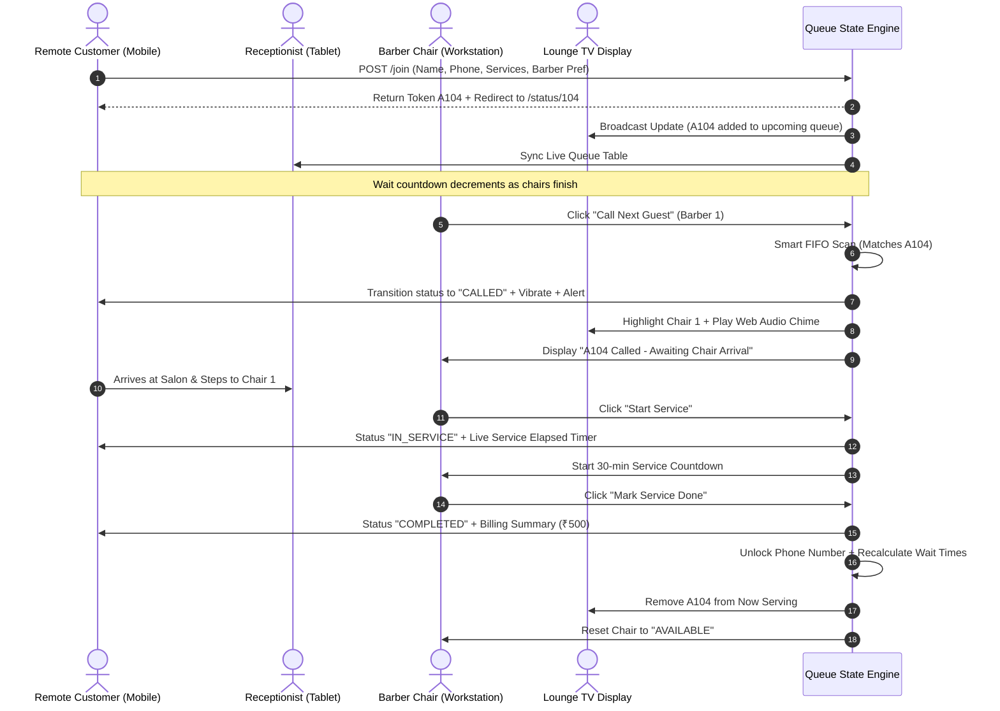
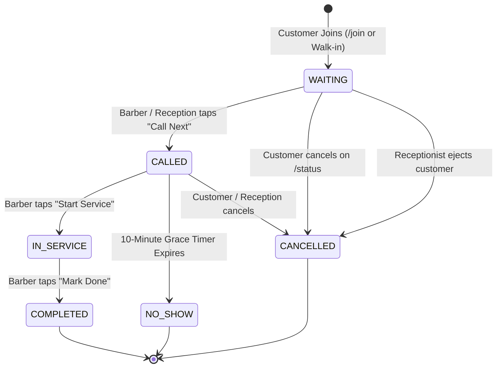

# 03 — Business Rules, Queue Logic & Edge Cases

> **VÉLORA — Real-Time Salon Queue Management System**  
> *The Art of Elevation · Beauty · Style · You*  
> *Deterministic State Machine, Algorithmic Wait Formulas & Comprehensive Test Matrix*

---

## 1. Step-by-Step Scenario Walkthroughs

---

### Scenario 1: Main Remote Customer Flow (Happy Path)
1. **Discovery & Selection**:
   - Customer opens `/join` on mobile browser.
   - Enters Name: *"Kavita Patel"*, Mobile: *"9825012345"*.
   - Selects two services: *Signature Haircut (30m)* + *Hair Spa Detox (45m)* = Total 75 minutes.
   - Selects Barber Preference: *"Meera (Chair 2)"*.
2. **Token Generation**:
   - Client submits form. Engine checks duplicate phone rule (cleared).
   - Token `A104` generated. Engine stores token in `localStorage` under `luxe_active_token`.
   - Browser navigates to `/status/t-104`.
3. **Remote Live Tracking**:
   - Patron sees: *"Token A104 · 2 Guests Ahead · Estimated Wait: ~35 Minutes"*.
   - Patron stays at a nearby café; the browser maintains real-time synchronization with the salon state.
4. **Approaching Alert Trigger**:
   - Preceding client finishes. Kavita’s position becomes #1, and estimated wait drops to 8 minutes ($\le 10$ minutes threshold).
   - Tracker morphs into an amber alert banner: *"Please start heading to the salon. You are next in line."*
5. **Call Notification & Arrival**:
   - Stylist Meera completes previous guest and clicks **"Call Next"**.
   - Token `A104` status transitions to `CALLED`.
   - Kavita's screen vibrates and triggers a full-screen gold alert: *"It's your turn! Please proceed to Chair 2 (Meera)"*.
   - Waiting lounge TV flashes Chair 2 and chimes.
6. **In-Chair & Completion**:
   - Kavita sits in Chair 2. Meera taps **"Start Service"**. Status moves to `IN_SERVICE`.
   - Service timer counts elapsed duration.
   - When finished, Meera taps **"Mark Done"**.
   - Kavita’s screen displays: *"Service completed. Thank you! Total bill: ₹1,400 payable at front desk."*
   - Phone number is immediately unlocked for future visits.

---

### Scenario 2: Walk-In Customer Flow at Reception
1. **Physical Arrival**:
   - Customer (*"Rohan Mehta"*) walks into the salon without a prior online token.
   - Approaches the reception counter. Receptionist Priya taps the floating **"+ Walk-In"** button on her iPad (`/reception`).
2. **Rapid Front-Desk Check-In**:
   - Modal appears. Priya inputs:
     - Name: *"Rohan Mehta"*
     - Mobile: *"9898011223"* (if customer declines, front desk taps default placeholder `9999999999`)
     - Services: *Signature Haircut (30m)*
     - Preference: *"Any Available (Fastest)"*
   - Priya taps **"Issue Token"** (total interaction time: < 12 seconds).
3. **Queue Insertion**:
   - Engine assigns next sequential token `A105`, marked with flag `isWalkIn: true`.
   - Token is appended **strictly to the bottom of the FIFO queue**.
   - Front desk hands customer a printed laminated token card `A105` or points to the Wall TV.
4. **Ambient Tracking**:
   - Rohan relaxes in the lounge. He sees `A105` appear immediately on the Wall TV screen (`/display`) with an estimated wait of ~20 minutes.
   - When his turn arrives, the TV chimes and highlights his chair.

---

### Scenario 3: Barber Workstation Operational Lifecycle
1. **Station Ready**:
   - Kabir logs into workstation `/barber/kabir` on his station mirror tablet.
   - Station displays current status: `AVAILABLE`.
   - "Upcoming in my queue" lists next 3 eligible customers.
2. **Calling the Next Patron**:
   - Kabir taps the prominent button: **"Call Next Guest"**.
   - Smart FIFO algorithm evaluates the queue and claims the first waiting patron matching Kabir or "Any Stylist".
   - Chair status transitions to `CALLING_GUEST`.
   - UI presents customer details, selected services, and a 10-minute grace timer.
3. **Starting the Service**:
   - Client arrives at Chair 1. Kabir confirms customer name and taps **"Start Service"**.
   - Station status becomes `IN_SERVICE`.
   - Visual progress bar starts advancing against the scheduled 30 minutes.
4. **Service Extension or Completion**:
   - If the hair styling requires extra time, Kabir taps **"+5 Min Extension"**, which automatically adjusts downstream salon wait estimates by +5 minutes.
   - When the haircut is complete, Kabir taps **"Mark Done"**.
   - System registers service completion, updates today's chair metrics, and returns workstation to `AVAILABLE`.

---

### Scenario 4: No-Show Handling & 10-Minute Grace Timer
1. **Guest Non-Appearance**:
   - Barber calls Token `A103`. Status becomes `CALLED`.
   - Client is not present in the waiting room or fails to respond within 2 minutes.
2. **Initiating Grace Period**:
   - Receptionist taps **"Mark No-Show Pending"** on `/reception`.
   - An automated **10-minute countdown grace timer** is initiated.
   - Customer's tracker screen flashes urgent Spiced Rust banner: *"Your turn was called! You have 09:59 minutes to report to the front desk before your token is surrendered."*
3. **Grace Expiration & Auto-Ejection**:
   - If 10 minutes elapse without check-in:
     - Token `A103` is transitioned to `NO_SHOW`.
     - Station is unblocked, allowing the barber to call the next patron.
     - Customer's screen updates: *"Token expired due to non-arrival."*
4. **Late Arrival Recovery Policy**:
   - If the customer arrives after expiration:
     - Staff does **not** displace current in-chair patrons.
     - Receptionist taps **"Re-add Guest"**, creating a fresh token appended strictly to the bottom of the active queue with priority note.

---

### Scenario 5: Customer Voluntary Cancellation
1. **Client Change of Plans**:
   - Customer tracking `A104` decides they cannot wait and taps **"Cancel My Spot"** on `/status/t-104`.
2. **Modal Confirmation**:
   - Modal prompt: *"Are you sure you want to leave the queue? Your spot (A104) will be permanently released."*
   - Options: `[Keep My Spot]` (Dismiss) or `[Confirm Cancellation]` (Destructive).
3. **System Rebalancing**:
   - Upon confirmation, token status updates to `CANCELLED`.
   - Customer's phone number is immediately released.
   - Engine triggers a downstream recalculation: All customers queued behind `A104` see their position advance by 1 and their estimated wait time decrease by 20 minutes in real time.

---

## 2. Queue State Machine Specification

### 2.1 State Transition Matrix

| Current State | Event / Trigger | Next State | Authorized Actor | Side Effects & Invariants |
|---|---|---|---|---|
| *None* | `JOIN_QUEUE` | `WAITING` | Customer / Reception | Validates phone number; assigns sequential `tokenNumber`; calculates initial wait time. |
| `WAITING` | `CALL_NEXT` | `CALLED` | Barber / Reception | Binds token to `assignedBarberId` and `chairNumber`; sets `calledAt = Date.now()`; plays chime on TV. |
| `WAITING` | `CANCEL_TOKEN` | `CANCELLED` | Customer / Reception | Unlocks phone number; recalculates wait times for downstream tokens. |
| `CALLED` | `START_SERVICE`| `IN_SERVICE` | Barber / Reception | Sets `serviceStartedAt = Date.now()`; sets barber status to `busy`; starts chair timer. |
| `CALLED` | `GRACE_EXPIRED`| `NO_SHOW` | System / Reception | Unlocks phone number; unbinds chair; frees barber to call next guest. |
| `CALLED` | `CANCEL_TOKEN` | `CANCELLED` | Customer / Reception | Unbinds chair; unlocks phone number; frees barber. |
| `IN_SERVICE` | `COMPLETE_SVC` | `COMPLETED` | Barber / Reception | Records completion timestamp; unlocks phone; increments `todayServed`; frees chair to `AVAILABLE`. |

### 2.2 Strict Invariant & Guard Rules
1. **Single-Chair Concurrency Guard**:
   - A styling chair can have **at most one** customer in `IN_SERVICE` state at any time.
   - Any attempt to trigger `CALL_NEXT` or `START_SERVICE` while a chair is occupied must throw a guarded error: `CHAIR_BUSY_CONCURRENCY_ERROR`.
2. **Duplicate Active Phone Guard**:
   - A single mobile number can only have **one** active token in `WAITING`, `CALLED`, or `IN_SERVICE` state.
   - Re-registration is blocked until the active token transitions to `COMPLETED`, `CANCELLED`, or `NO_SHOW`.
3. **No Backwards State Jumps**:
   - Transitions are strictly unidirectional. A token in `COMPLETED` cannot transition back to `IN_SERVICE` or `WAITING`.
4. **Service Selection Boundary**:
   - A customer cannot select 0 services, nor can they select $> 3$ services in a single queue token.

---

## 3. Mathematical Wait Time Formula

The system computes dynamic wait estimates using a deterministic, multi-server queue scheduling formulation.

### 3.1 Global Wait Time Formula ("Any Barber")

For a customer $k$ who selected "Any Available (Fastest)" or for the general salon queue pulse:

$$\text{Estimated Wait Time (minutes)} = \left\lceil \frac{\sum_{i \in \text{Ahead}(k)} \text{RemainingDuration}(i)}{N_{\text{active}}} \times \frac{1}{5} \right\rceil \times 5$$

Where:
* $\text{Ahead}(k)$: Set of all active tokens ahead of customer $k$ in the queue (including patrons currently in chair).
* $\text{RemainingDuration}(i)$:
  - For patrons in `WAITING` or `CALLED`: $\sum \text{ServiceDuration}$.
  - For patrons in `IN_SERVICE`: $\max(0, \text{TotalDuration} - \text{ElapsedTime})$.
* $N_{\text{active}}$: Total count of styling chairs currently in `on_duty` shift status (excluding stylists on break or off-duty).
* $\lceil \dots \rceil \times 5$: Rounds up to the nearest 5-minute interval for consumer clarity (e.g., 21 min $\rightarrow$ 25 min, 12 min $\rightarrow$ 15 min).

### 3.2 Specific Barber Routing Formula

When a customer $k$ requests a specific stylist (e.g., Kabir):

$$\text{Estimated Wait Time}_{\text{Barber } X} = \sum_{j \in \text{Dedicated}(X)} \text{RemainingDuration}(j) + \alpha \sum_{m \in \text{AnyAhead}} \text{RemainingDuration}(m)$$

Where:
* $\text{Dedicated}(X)$: All customers ahead who specifically requested Barber $X$.
* $\text{AnyAhead}$: Customers ahead who requested "Any Available", weighted by Barber $X$'s proportional capacity $\alpha = \frac{1}{N_{\text{active}}}$.

### 3.3 Zero-Barber Guard (All Stylists on Break / Offline)
* **Trigger Condition**: $N_{\text{active}} == 0$.
* **System Reaction**:
  1. Estimated wait time displays as: *"Queue Paused — Stylists on Shift Change"*.
  2. The `/join` page displays a warning toast: *"All stylists are currently on scheduled break. You may still join, but wait times will resume upon shift return."*
  3. Workstation and Receptionist "Call Next" buttons are disabled with tooltip: *"No stylists on duty"*.

---

## 4. 15-Point Verification Test Checklist

This test suite covers all edge cases, business rules, and multi-device state synchronization:

| # | Test Case Description | Initial Condition | Action / Input | Expected Result & Verification |
|---|---|---|---|---|
| **1** | **Standard Remote Join** | Clean queue | Submit `/join` with valid Name, 10-digit phone, 2 services, "Any Barber". | Token generated (e.g. `A101`), saved to `localStorage`, redirected to `/status/:id`, wait time displayed. |
| **2** | **Duplicate Phone Guard** | Token `A101` active for `9825012345` | Submit `/join` with identical phone `9825012345`. | Submission blocked. Error: *"This number already has an active token (Token A101)"*. |
| **3** | **Max 3 Services Guard** | On `/join` | Select 3 services, attempt to click 4th service. | 4th checkbox disabled; warning message: *"Maximum 3 services allowed"*. |
| **4** | **Walk-In Append Order** | Active queue `A101` (waiting) | Receptionist creates walk-in token `A102` via `/reception`. | Token `A102` created with `isWalkIn: true`; placed strictly behind `A101` at queue tail. |
| **5** | **Smart FIFO Barber Dispatch** | `A101` wants Meera; `A102` wants Kabir | Barber Kabir clicks "Call Next Guest". | System skips `A101` and calls `A102` for Kabir. `A101` remains 1st in line for Meera. |
| **6** | **"Any Barber" FIFO Claim** | `A101` wants "Any"; `A102` wants Kabir | Barber Meera clicks "Call Next Guest". | System claims `A101` for Meera. `A102` remains waiting for Kabir. |
| **7** | **Single-Chair Concurrency Guard** | Barber 1 is `IN_SERVICE` with `A101` | Attempt to trigger "Call Next" on Barber 1 workstation. | Action disabled/blocked. Error: *"Cannot call next guest while chair is in service"*. |
| **8** | **Timer Lifecycle Transition** | `A101` in `CALLED` state | Barber clicks "Start Service". | Status moves to `IN_SERVICE`; elapsed timer starts counting upward from `00:00`. |
| **9** | **Approaching Turn Warning** | Customer `A103` is 3rd in line | Preceding tokens called; `A103` becomes 1st in line (wait $\le 10$m). | Screen transitions to amber warning: *"Please start heading to the salon"*; vibration triggers. |
| **10** | **"It's Your Turn" Fullscreen Alert** | Customer `A103` is `WAITING` | Barber calls `A103`. | Customer screen displays full-screen gold alert; displays Chair # and Barber Name. |
| **11** | **Wall TV Chime & Visual Flash** | `/display` open on wall screen | Any barber triggers "Call Next". | TV displays animated pulse border on assigned chair; Web Audio two-tone chime sounds without error. |
| **12** | **Customer Self-Cancellation** | `A104` waiting in line | Customer clicks "Cancel My Spot" on `/status/104` and confirms. | Status becomes `CANCELLED`; downstream wait times decrease; phone number unlocked. |
| **13** | **No-Show 10-Minute Grace Ejection** | Customer `A102` called | Customer does not arrive; 10-minute grace timer expires. | Receptionist marks `NO_SHOW`; chair is unblocked; token removed from active display. |
| **14** | **Bilingual Toggle Persistence** | App in English | Switch header toggle to Gujarati (`ગુજ`). Refresh page. | All labels, headers, and buttons render in Gujarati; preference persists in `localStorage`. |
| **15** | **Cross-Tab Real-Time Sync (< 5s)** | Open `/reception` in Tab A and `/display` in Tab B | Click "Call Next" in Tab A. | Tab B updates within 1 second via BroadcastChannel / localStorage sync event. |
